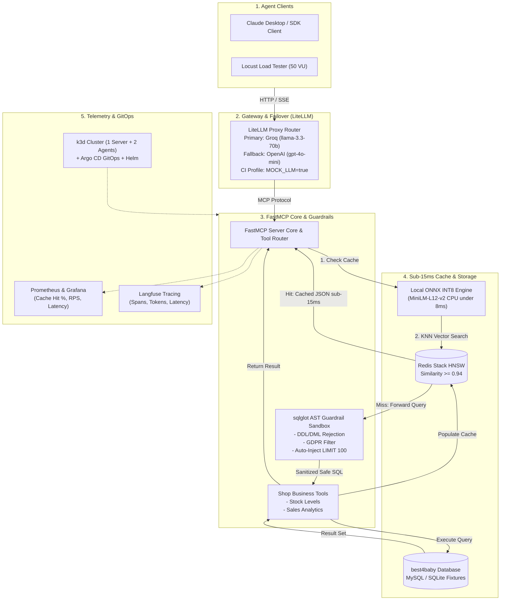

# MCP-Based Corporate Agent Platform with Semantic Caching and GitOps (LLM + Platform MLOps)

Enterprise-grade, high-throughput Model Context Protocol (MCP) gateway and corporate agent platform. Grants LLMs safe access to relational databases (OpenCart `best4baby` catalog & sales), safeguards against data destruction and GDPR leaks via AST guardrails, accelerates repetitive queries using a sub-15ms local ONNX INT8 semantic cache with Redis HNSW, load-balances requests across local and cloud LLM providers with automatic failover via LiteLLM, and enforces production MLOps/GitOps via multi-node K3s (`k3d`), Helm, Argo CD, Prometheus, Grafana, and Langfuse.

---

## 1. High-Level Architecture



---

## 2. Core Technical Components

### Component A: AST SQL Security Sandbox Guardrails
Direct LLM access to databases risks data destruction or GDPR customer leaks. Instead of naive string filtering (e.g. searching for `"DROP"`), query safety is enforced through Abstract Syntax Tree (AST) analysis:
- **`sqlglot` Parser**: Parses MySQL dialects into syntax trees.
- **Strict Read-Only Enforcement**: Immediately rejects statements containing `Insert`, `Update`, `Delete`, `Drop`, `Alter`, `Create`, `Truncate`, or stacked multi-statements.
- **GDPR Redaction**: Blocks access to tables `oc_customer` and `oc_user`, and blacklists sensitive columns (`telephone`, `email`, `password`, `salt`, `token`, `ip`).
- **On-the-Fly Query Mutation**: Automatically appends `LIMIT 100` if absent, or caps existing limits to 100.

### Component B: Sub-15ms Local Semantic Cache
- **Embedding Model**: `sentence-transformers/paraphrase-multilingual-MiniLM-L12-v2` (384 dimensions).
- **ONNX INT8 Quantization**: Dynamic INT8 quantization runs on CPU with inference latency under 8 ms (no GPU required).
- **Redis HNSW Index**: Redis Stack HNSW cosine vector index (`idx:semantic_cache`).
- **Cosine Threshold**: If vector similarity $\ge 0.94$, the cached JSON payload is returned immediately (<15 ms total response time, 0 LLM tokens, 0 DB load).

### Component C: Hybrid LiteLLM Gateway & Failover
- **Proxy Router**: Central entry point in front of MCP tools.
- **Failover Routing**:
  1. *Primary*: `groq/llama-3.3-70b-versatile` (or local vLLM/Ollama instance).
  2. *Production Fallback*: `openai/gpt-4o-mini`.
  3. *Offline / CI Mode*: Configurable via `MOCK_LLM=true` to simulate network latencies, timeouts, and 500 error failover without requiring API keys.
- **SLA & Timeouts**: Requests timing out after 2.5 seconds or returning HTTP 500/503/429 automatically fail over without session interruption.

### Component D: GitOps, Infrastructure & Observability
- **Kubernetes**: 3-node K3s cluster simulated locally via `k3d` (1 server + 2 agents).
- **Helm Charts**: Declarative deployment manifests for MCP Server, LiteLLM, Redis Stack, MySQL, and Prometheus exporters.
- **GitOps with Argo CD**: Continuous reconciliation of cluster state with git repository commits.
- **Full Observability**:
  - *Prometheus + Grafana*: Tracks Cache Hit Ratio, RPS, p50/p95/p99 latency, and AST rejection metrics.
  - *Langfuse*: Traces step-by-step tool execution, token consumption, and hallucination scores.

---

## 3. Project Directory Structure

```
mcp_corporate_agent_platform/
├── .github/
│   └── workflows/
│       ├── ci.yml                 # Linting, unit tests, security AST tests
│       └── eval_prompt_ci.yml     # Automated prompt evaluation & regression checks
├── configs/
│   ├── claude_desktop_config.json # Claude Desktop MCP connection configuration
│   ├── litellm_config.yaml        # Hybrid LiteLLM routing, failover, timeouts & mock profile
│   └── prometheus.yml             # Prometheus scrape configuration
├── data/
│   ├── fixtures/
│   │   ├── init_best4baby.sql     # Full MySQL database schema & seed fixtures
│   │   └── seed_sqlite.py         # SQLite fixture generator for instant local testing
│   └── eval_dataset.json          # 50+ benchmark test cases (legitimate, SQLi, GDPR, cache hits)
├── deploy/
│   ├── docker-compose.yml         # Local stack (MCP, Redis-Stack, LiteLLM, MySQL, Prometheus, Grafana)
│   └── k8s/
│       ├── k3d-cluster.yaml       # k3d 3-node cluster topology definition (1 server + 2 agents)
│       ├── argocd/
│       │   └── application.yaml   # Argo CD Application manifest for GitOps
│       └── helm/
│           └── mcp-platform/      # Production Helm chart
│               ├── Chart.yaml
│               ├── values.yaml
│               ├── values-k3d.yaml
│               └── templates/
│                   ├── mcp-server.yaml
│                   ├── litellm.yaml
│                   ├── redis.yaml
│                   ├── mysql.yaml
│                   ├── configmaps.yaml
│                   └── ingress.yaml
├── dashboards/
│   └── grafana/
│       └── mcp_platform_dashboard.json # Grafana dashboard (Cache Hit Ratio, RPS, Latencies, Rejections)
├── scripts/
│   ├── export_onnx_model.py       # Script to export & quantize HF model to ONNX dynamic INT8
│   └── setup_cluster.ps1          # Helper script to bootstrap k3d and Argo CD
├── src/
│   ├── __init__.py
│   ├── cache/
│   │   ├── __init__.py
│   │   ├── embeddings.py          # ONNX Runtime INT8 local CPU inference engine (<8ms)
│   │   └── semantic_cache.py      # Redis HNSW vector store + similarity threshold logic (>=0.94)
│   ├── core/
│   │   ├── __init__.py
│   │   ├── config.py              # Pydantic Settings (DB URLs, Redis, LiteLLM, Langfuse, MOCK_LLM)
│   │   ├── db.py                  # Dual-engine DB manager (MySQL + SQLite)
│   │   └── telemetry.py           # Prometheus metrics & Langfuse trace instrumentation
│   ├── security/
│   │   ├── __init__.py
│   │   ├── ast_guardrails.py      # sqlglot AST parser, DDL/DML rejection, GDPR blacklist, LIMIT enforcer
│   │   └── schemas.py             # Pydantic input/output validation models
│   ├── server/
│   │   ├── __init__.py
│   │   ├── mcp_server.py          # FastMCP server definition & tool registry
│   │   └── tools/
│   │       ├── __init__.py
│   │       ├── sql_tool.py        # Safe SQL execution tool with AST validation & semantic caching
│   │       ├── catalog_tool.py    # best4baby stock levels (oc_product_option_value)
│   │       └── sales_tool.py      # best4baby sales analytics (oc_order)
│   └── gateway/
│       ├── __init__.py
│       └── litellm_client.py      # Client interface communicating via LiteLLM proxy / mock mode
├── tests/
│   ├── __init__.py
│   ├── test_ast_guardrails.py     # AST security tests (DML/DDL rejection, GDPR blocking, LIMIT injection)
│   ├── test_embeddings.py         # ONNX INT8 latency & cosine similarity tests
│   ├── test_semantic_cache.py     # Redis HNSW cache hit/miss behavior tests
│   ├── test_mcp_tools.py          # FastMCP tool logic tests against fixture DB
│   └── eval_suite.py              # 50+ benchmark evaluation runner with accuracy & safety scoring
├── locustfile.py                  # Locust load test simulating 50 concurrent analytics sessions
├── pyproject.toml                 # uv / pip dependency configuration
└── README.md                      # Production architecture documentation & quickstart
```

---

## 4. 8-Week Implementation Roadmap

| Phase | Milestone Focus | Key Deliverables |
| :--- | :--- | :--- |
| **Weeks 1–2** | **Core Server & Database** | FastMCP server, `best4baby` MySQL fixtures (`oc_product_option_value`, `oc_order`), Docker Compose base. |
| **Weeks 3–4** | **Security & Semantic Cache** | `sqlglot` AST guardrail sandbox, ONNX INT8 quantization script, Redis HNSW semantic cache, LiteLLM failover config. |
| **Weeks 5–6** | **Telemetry, Eval & GitOps** | Langfuse tracing, Prometheus exporter & Grafana dashboard, 50+ query eval dataset, K3s/Minikube Helm chart & Argo CD application. |
| **Weeks 7–8** | **Load Testing, CI & Portfolio** | Locust 50-user load test, GitHub Actions CI prompt validation, Claude Desktop integration config, comprehensive documentation & Mermaid diagrams. |

---

## 5. Verification Strategy

1. **AST Guardrail Unit Tests**: `uv run pytest tests/test_ast_guardrails.py -v` (100% block rate on DDL, DML, and GDPR leaks).
2. **ONNX INT8 Latency Benchmark**: `uv run pytest tests/test_embeddings.py -v` (asserts CPU latency < 8 ms).
3. **Semantic Cache Verification**: `uv run pytest tests/test_semantic_cache.py -v` (asserts hit at $\ge 0.94$, miss at $< 0.94$).
4. **Synthetic Evaluation Suite**: `uv run python tests/eval_suite.py` (evaluates 50+ queries covering accuracy, safety, and cache efficiency).
5. **Locust Stress Testing**: `locust -f locustfile.py --headless -u 50 -r 5 --run-time 1m` (measures throughput and p95/p99 latency under concurrency).
