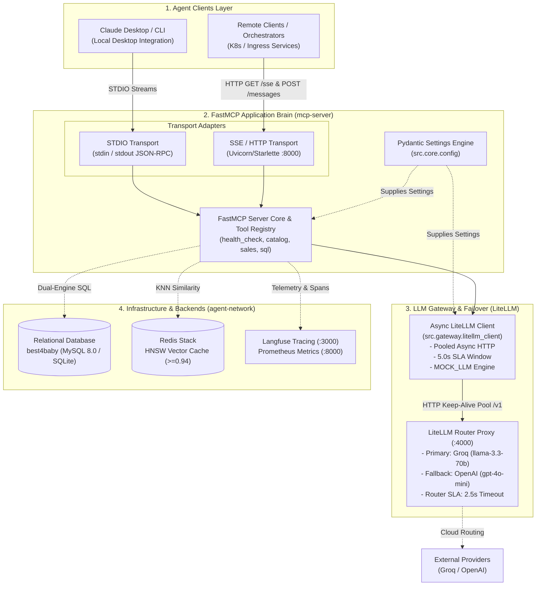

# Step AI-1 Completion Report: Project Scaffolding, FastMCP Protocol & Gateway Architecture

## 1. Executive Summary

This report documents the architectural design, implementation details, and verification outcomes for **Step AI-1: Project Scaffolding & FastMCP Core Protocol** of the **MCP Corporate Agent Platform**.

The primary objective of Step AI-1 was to establish a production-grade Python package foundation and FastMCP server capable of bridging local desktop AI clients (Claude Desktop) with containerized cloud/orchestrated environments (Docker, Kubernetes/K3s), reinforced by centralized configuration management and high-throughput model gateway routing.

---

## 2. High-Level System Architecture

The diagram below illustrates the architectural boundaries established in Step AI-1 and how incoming requests navigate through the platform components:



---

## 3. Core Architectural Components

### 3.1 Dual-Transport Protocol (`src/server/mcp_server.py`)

The platform implements a unified server definition that dynamically binds to either transport mode based on runtime flags and environment variables:

| Attribute | **STDIO Transport** | **SSE / HTTP Transport** |
| :--- | :--- | :--- |
| **Execution Context** | Local developer machines, Claude Desktop | Docker containers, Kubernetes Pods, CI runners |
| **I/O Mechanism** | Standard streams (`sys.stdin` / `sys.stdout`) | Server-Sent Events (`GET /sse`) + HTTP POST (`/messages/`) |
| **Network Footprint** | Zero open ports; local subprocess | Binds to `0.0.0.0:8000` |
| **Logging Rule** | **Strict**: All logs strictly routed to `sys.stderr` | Standard logging routed to `sys.stderr` / stdout |
| **Activation** | `--transport stdio` (default) | `--transport sse --host 0.0.0.0 --port 8000` |

#### Standard Stream Protection
When operating over `stdio`, arbitrary `print()` statements to `stdout` will corrupt the JSON-RPC framing and sever client connections. All server logging is routed exclusively through `logging.basicConfig(stream=sys.stderr)` with explicit timestamping and log levels.

---

### 3.2 Centralized Settings Engine (`src/core/config.py`)

Configuration management is implemented via Pydantic Settings v2 (`BaseSettings`), enforcing strict validation, `.env` file ingestion, and multi-alias resolution:

1. **Dual-Engine Relational Storage**:
   - Supports both `sqlite` (for instant unit testing and local CI without Docker) and `mysql` (for production/Docker environments).
   - Dynamic connection string assembly via `@computed_field` property `database_url`:
     - SQLite: `sqlite:///{sqlite_path}`
     - MySQL: `mysql+pymysql://{user}:{password}@{host}:{port}/{name}`
2. **Semantic Cache & Vector Search Parameters**:
   - `similarity_threshold`: Configured to `0.94` cosine similarity threshold for vector cache hits.
   - `cache_ttl_seconds`: Defaults to `86400` (24-hour cache invalidation).
   - `embedding_dim`: 384 dimensions matching `sentence-transformers/paraphrase-multilingual-MiniLM-L12-v2`.
3. **LiteLLM Gateway SLA Timers**:
   - `litellm_timeout`: Defaults to `5.0s`.
   - `litellm_max_connections`: 100 simultaneous pooled connections.
   - `litellm_max_keepalive`: 20 reusable idle sockets.
4. **Platform Mode & Transport Flags**:
   - `mock_llm`: Boolean switch enabling deterministic offline query generation.
   - `mcp_transport`, `mcp_host`, `mcp_port`: Configures server ingress.

---

### 3.3 High-Throughput Async Gateway Client (`src/gateway/litellm_client.py`)

The LiteLLM client provides a resilient bridge between FastMCP tool handlers and the LiteLLM proxy router:

1. **Non-Blocking AsyncIO (`acomplete`)**:
   - FastMCP runs on an asynchronous event loop (`asyncio`). Synchronous HTTP requests would freeze the event loop and stall concurrent user queries. `acomplete()` yields execution back to the loop during network waits.
2. **Persistent HTTP Keep-Alive Connection Pooling**:
   - Configured with `httpx.Limits(max_connections=100, max_keepalive_connections=20, keepalive_expiry=30.0)`.
   - Eliminates TCP handshake overhead (20–50ms saved per query) and prevents socket exhaustion under the 50-virtual-user Locust benchmark.
3. **SLA Timeout Hierarchy**:
   $$\text{Client SLA Timeout (5.0s)} \ge \text{LiteLLM Primary SLA (2.5s)} + \text{LiteLLM Fallback SLA (2.5s)}$$
   - Prevents the client from aborting while LiteLLM is in the middle of executing its automatic failover from Groq to OpenAI.
4. **Token Usage & Latency Extraction**:
   - Extracts structured `usage` (`prompt_tokens`, `completion_tokens`, `total_tokens`) and `latency_ms` into `ChatCompletionResult` for ingestion by Prometheus and Langfuse.
5. **Context-Aware Offline Mocking (`MOCK_LLM=true`)**:
   - Simulates model execution with configurable delay (`0.05s`) and context-sensitive SQL heuristics (catalog vs sales) to enable full CI/CD test execution without live API credits.

---

### 3.4 Containerized Infrastructure Alignment (`deploy/docker-compose.yml`)

The `mcp-server` service was aligned with the multi-container stack:
- **Direct Entrypoint**: Configured to run `python -m src.server.mcp_server --transport sse --host 0.0.0.0 --port 8000`.
- **Environment Parity**: Injected `MCP_TRANSPORT=sse`, `LITELLM_MASTER_KEY`, `LITELLM_TIMEOUT=5.0`, and database credentials.
- **Liveness Healthcheck**: Implemented HTTP GET probing against `http://localhost:8000/sse` to signal readiness to dependent containers.

---

## 4. Verification & Validation Evidence

### Task Verification: FastMCP Server CLI
Executing the server verification command within the virtual environment:

```powershell
uv run python -m src.server.mcp_server --help
```

**Output**:
```text
usage: python.exe -m src.server.mcp_server [-h] [--transport {stdio,sse}]
                                           [--host HOST] [--port PORT]

Corporate Agent FastMCP Server

options:
  -h, --help            show this help message and exit
  --transport {stdio,sse}
                        Transport protocol: 'stdio' for desktop clients, 'sse'
                        for HTTP/container deployments
  --host HOST           HTTP host for SSE
  --port PORT           HTTP port for SSE
```

### Build & Environment Integrity
- **Build Backend**: Configured `hatchling` in `pyproject.toml` with packages targeting `src`.
- **Dependency Resolution**: Locked 130 dependencies cleanly via `uv.lock`.
- **VCS Sanitation**: Standardized `.gitignore` encoding to UTF-8 without BOM to eliminate build-time Unicode decoding errors.

---

## 5. Milestone Completion Checklist

- [x] **Task 1**: Defined package dependencies in `pyproject.toml` (`fastmcp`, `sqlglot`, `onnxruntime`, `tokenizers`, `redis`, `sqlalchemy`, `pydantic`).
- [x] **Task 2**: Implemented `src/server/mcp_server.py` initializing `FastMCP("corporate-agent-platform")`.
- [x] **Task 3**: Enabled dual transport supporting `stdio` (Claude Desktop) and `sse` (Docker / Kubernetes).
- [x] **Task 4**: Created `src/core/config.py` using `pydantic-settings` to load DB URLs, Redis parameters, similarity threshold (`0.94`), and mode flags.
- [x] **Verification**: `uv run python -m src.server.mcp_server --help` passes cleanly with exit code 0.
